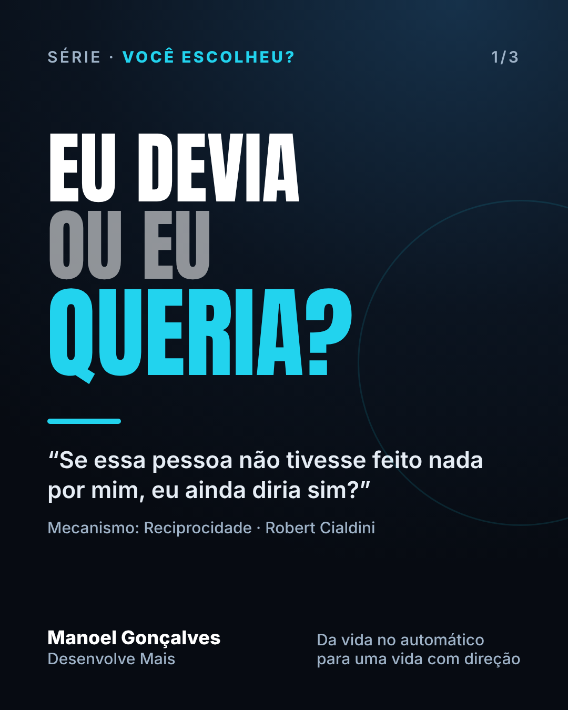
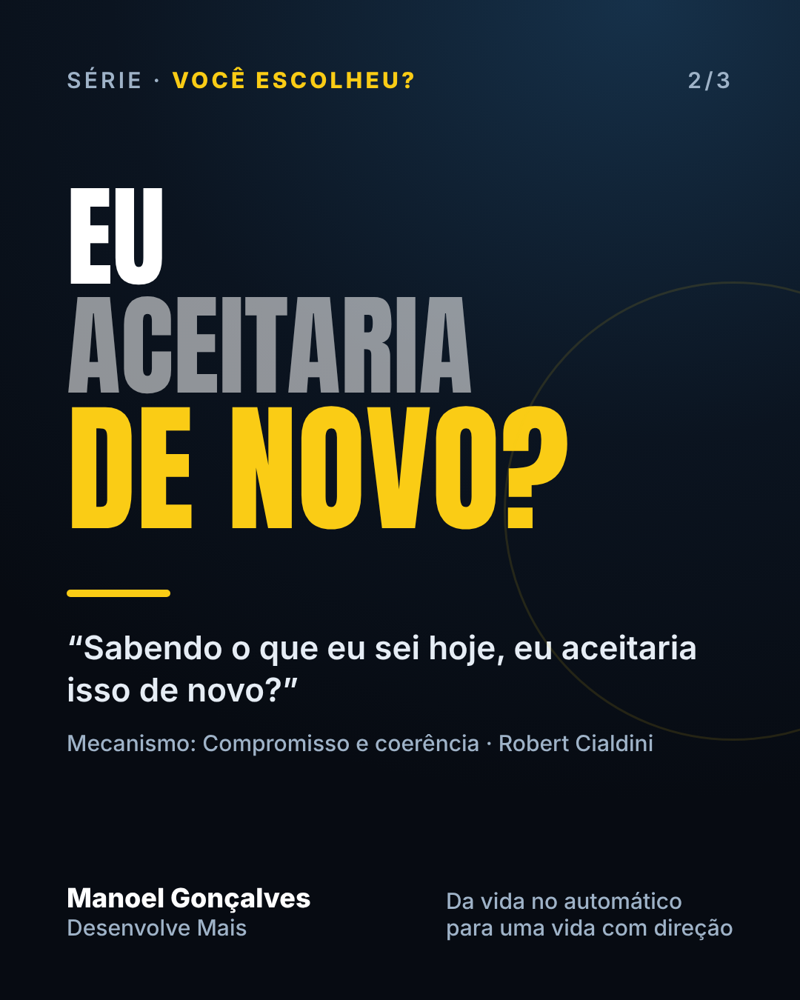
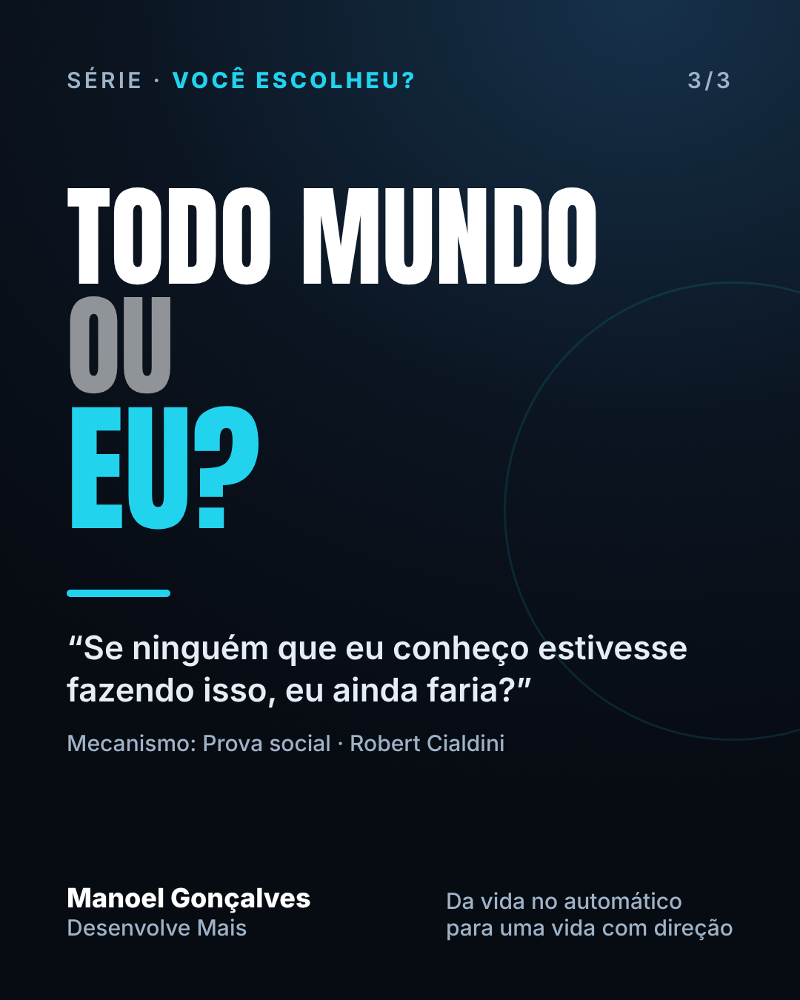

# LinkedIn — Série "Você escolheu?" (base: As Armas da Persuasão)

**Status:** RASCUNHO — aguardando aprovação do Manoel
**Canal:** LinkedIn pessoal "Manoel Gonçalves" (via mLabs, ativo)
**Objetivo do teste:** gerar conversas de orientação pelo WhatsApp (não curtidas).
**Medição:** em 14 dias, quantas pessoas chamaram no WhatsApp citando o LinkedIn.

Agenda proposta (horário de Brasília — sem dado de melhor horário, é chute inicial):

| # | Mecanismo | Data proposta |
|---|---|---|
| 1 | Reciprocidade | qui 26/11/2026, 8h |
| 2 | Compromisso e coerência | ter 01/12/2026, 8h |
| 3 | Prova social | qui 03/12/2026, 8h |

Observações:
- Imagens: artes tipográficas 1080x1350 (4:5) em `artes/`. Para trocar texto/cor, editar `artes/gerar.js` e rodar `node gerar.js`. Quando houver foto real do Manoel, dá para incluí-la.
- Link do WhatsApp vai **no primeiro comentário**, não no texto (hipótese comum de que link no corpo reduz alcance — não comprovado).
- Lote sem histórias pessoais do Manoel (decisão de 25/11/2026): os textos não dependem dele para ir ao ar.
- Se o vídeo do YouTube já estiver no ar, dá para pôr o link dele também no comentário.

---

## Post 1 — Reciprocidade

**Imagem:** `artes/post1.png`

Você já disse SIM só porque a pessoa tinha feito algo por você antes?

Não porque fazia sentido. Não porque você queria. Mas porque ficou aquele peso, né, aquela sensação de "poxa, ele me ajudou, agora não dá pra recusar".

O Robert Cialdini chama isso de reciprocidade. É um dos atalhos mais antigos que a gente tem: recebeu, devolve.

E olha, isso não é defeito. É o que faz a gente ser grato, ser leal, manter relação.

O problema é quando a dívida decide no seu lugar.

É a amostra grátis no supermercado que faz você levar o pacote inteiro. É o colega que te cobriu numa reunião e agora pede um favor que vai custar seu fim de semana. É o "presentinho" antes da proposta comercial.

Eu me pego nisso também. Por isso criei uma pergunta simples pra mim:

"Se essa pessoa não tivesse feito nada por mim, eu ainda diria sim?"

Se a resposta for não, o seu sim não é escolha. É pagamento.

Gratidão é bonita. Dívida emocional decidindo sua agenda, não.

E você, qual foi o último sim que você deu só porque se sentiu em dívida?

#DesenvolvimentoPessoal #Comportamento #TomadaDeDecisão

**1º comentário (postar logo depois):**
> Esse é um dos temas que eu trabalho individualmente: entender como você decide, se comunica e reage sob pressão. Se quiser conversar sobre isso, me chama no WhatsApp: https://wa.me/5512991337474

---

## Post 2 — Compromisso e coerência

**Imagem:** `artes/post2.png`

Tem decisão que você não toma. Você só continua.

Você disse um "sim" pequeno lá atrás. Depois outro. Depois mais um. E quando viu, tá carregando um compromisso enorme que você nunca escolheu de verdade, né?

O Cialdini explica: a gente tem uma necessidade forte de parecer coerente com o que já disse ou fez. Mudar de ideia parece fraqueza. Parece que você vai perder a cara.

Aí acontece assim: "você pode me ajudar só com isso?" vira "já que você ajudou, pode cuidar disso também?" vira um projeto inteiro no seu colo.

No trabalho. Na família. Na igreja. No relacionamento.

Coerência é virtude quando você está sendo fiel a um valor.

Vira armadilha quando você está sendo fiel só a uma frase que disse sem pensar.

A pergunta que eu uso:

"Sabendo o que eu sei hoje, eu aceitaria isso de novo?"

Se não, você não precisa continuar só pra não parecer incoerente. Rever uma decisão é responsabilidade, não fraqueza.

Qual compromisso você está mantendo só porque já começou?

#DesenvolvimentoPessoal #Autoconhecimento #Responsabilidade

**1º comentário:**
> Se você sente que vive mais no automático das decisões antigas do que nas escolhas de hoje, é exatamente isso que eu trabalho em orientação individual. Me chama: https://wa.me/5512991337474

---

## Post 3 — Prova social

**Imagem:** `artes/post3.png`

"Todo mundo tá fazendo."

Essa frase já decidiu mais coisa na sua vida do que você imagina.

O curso que todo mundo comprou. A carreira que todo mundo achou segura. O restaurante cheio que parece melhor que o vazio do lado. O jeito de viver que todo mundo da sua idade já "deveria" ter.

O Cialdini chama isso de prova social: quando a gente não tem certeza, olha pros outros pra saber o que fazer.

E faz sentido, tá? Em muita situação isso protege a gente.

Mas tem um detalhe: os outros também estão olhando pros outros. Às vezes é todo mundo seguindo todo mundo, e ninguém escolheu nada.

A pergunta que eu deixo:

"Se ninguém que eu conheço estivesse fazendo isso, eu ainda faria?"

Seguir o grupo é fácil. Construir uma vida com direção dá trabalho, porque às vezes o caminho certo pra você é o que está vazio.

Existe uma vida só. Não dá pra vivê-la no automático dos outros.

Qual decisão sua foi mais "todo mundo" do que "eu"?

#DesenvolvimentoPessoal #Propósito #Comportamento

**1º comentário:**
> Esta série nasceu do livro As Armas da Persuasão, do Robert Cialdini. Se você quer olhar com mais atenção para como você toma decisões, eu faço esse trabalho individualmente. Conversa pelo WhatsApp: https://wa.me/5512991337474
